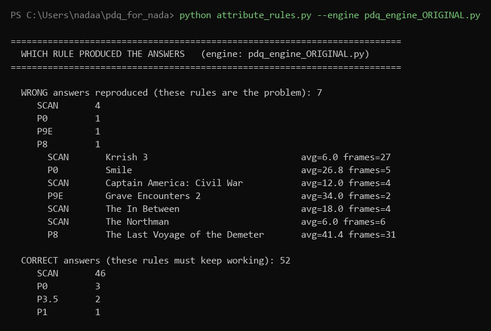
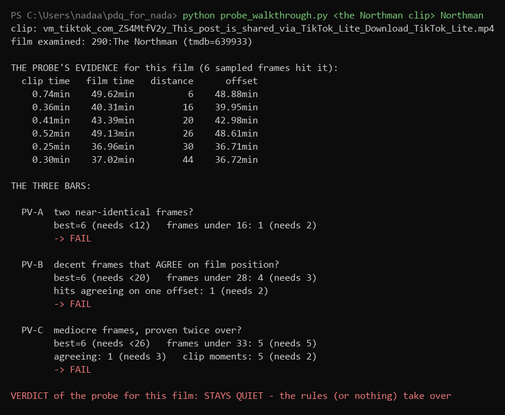
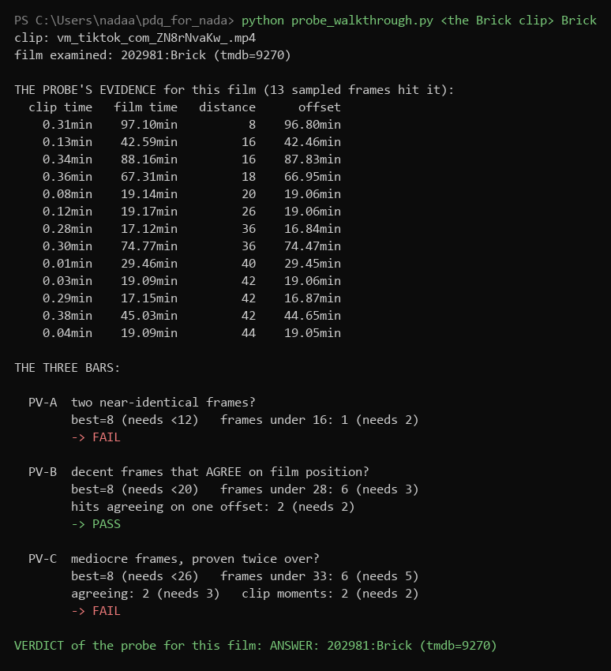
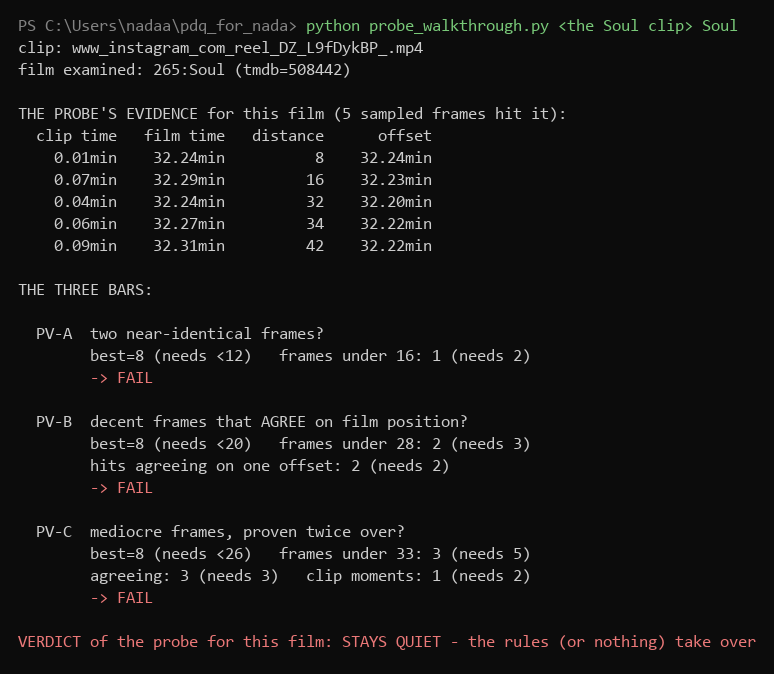
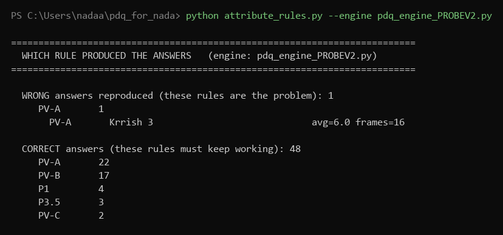
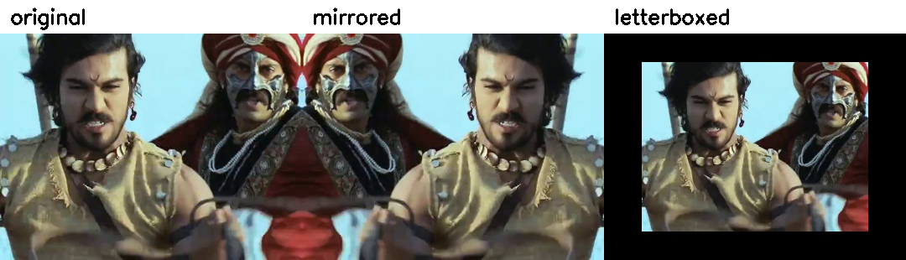

# PDQ: the week in numbers

*4 October 2026. Nada.*

| | before | after |
|---|---|---|
| wrong answers (125 clips) | 7 | **1** |
| correct answers | 52 | 48 |
| mirrored clips identified | 0 of 8 | **8 of 8** |
| letterboxed clips identified | 1 of 8 | **6 of 8** |

---

## 1. What was working before, and how

The pod's engine, as a verified laptop copy. Three parts can answer, tried in this order:

| part | what it is | how it decides | its results (125 clips) |
|---|---|---|---|
| pre-scan | a quick skim before anything else: 40 frames spread across the whole clip | counts hits: 3 frames under distance 28, best under 20. Never asks whether hits agree on film position or come from several clip moments | most answers: 46 correct, but also 4 of the 7 wrong |
| probe P0 | one quick look at the first 4 seconds, one crop shape only | a single frame under distance 30 is enough to answer | 3 correct, 1 wrong |
| rules P1-P9 | scorecards per film, watched as the clip is read; first rule to fire wins | the careful mid rules check agreement and clip spread; the weak ones (P8, P9E) mostly count mediocre frames | 3 correct, 2 wrong |
| all together | quick parts answer first, so the careful checks are rarely reached | counting decides most of the traffic | **52 correct, 7 wrong** |

## 2. Where the wrong answers came from

- A true match gives the same offset (film time minus clip time) for every frame.
  Nothing that decides most of the traffic checks this.
- All 125 clips run, every answer tagged with the rule that produced it:

| rule | wrong answers | distance |
|---|---|---|
| pre-scan | 4 (Krrish 3, Northman, Civil War, In Between) | 6 - 18 |
| P0 probe | 1 (Smile) | 26.8 |
| P9E | 1 (Grave Encounters 2) | 34.0 |
| P8 | 1 (Demeter) | 41.4 |

- Four of seven come from the pre-scan, before any rule runs. Rule changes can never
  reach them. That is why the tech had to change, not the thresholds.

## 3. What I built

| built | how it works | measured result |
|---|---|---|
| attribution testing | every clip run records which rule produced the answer | the table above; every change judged by re-running all 125 clips |
| the probe V2 | 40 frames across the whole clip; each fingerprinted in every view (full, caption-trimmed, all crops, mirrored, bars removed); a scorecard per film with every hit's film position; answers only on the three bars below | on its own: 1 wrong, 41 correct |
| P0 retired, P9E floor | no more one-frame answers; two frames only count for P9E when the average is 25 or better | removes Smile and Grave Encounters 2 |
| the edits harness + 2 fixes | 10 reposter edits x 8 clips that work unedited; the probe now fingerprints mirrored views and cuts black bars first | mirror 0/8 to 8/8; letterbox 1/8 to 6/8 |
| drop-in mode | the probe decides what it trusts; everything it declines falls through to the rules, which read the clip densely | **1 wrong, 48 correct** |

## 4. How the probe decides: the three bars

The ladder: the better the pictures, the less agreement demanded.

| bar | needs | copied from | impact (of the 41) |
|---|---|---|---|
| PV-A | 2 near-identical frames | P2.5 | lets in 22 |
| PV-B | 3 decent frames, best under 20, 2 agreeing on film position | pre-scan + P4 | lets in 17; refuses Northman, Civil War, In Between |
| PV-C | 5 medium frames, 3 agreeing, from 2 clip moments | P6a | lets in 2 |

**Proof, on real clips. Both pass the OLD pre-scan bar; only the agreement question
separates them:**

**And the honest third case: a true scene with thin evidence. Perfect agreement
(every offset 32.2) but too few frames, so the probe declines - and the fallback
rules then name Soul via P1. Declined is not lost:**

## 5. Results

**Real clips, all 125:**

| engine | wrong | correct |
|---|---|---|
| pod's rules | 7 | 52 |
| new probe alone | 1 | 41 |
| **new probe + rules backup** | **1** | **48** |

- The 1 left: Krrish 3, distance 6, identical pictures. Needs audio / SSCD.
- The 4 lost: fan edits that jump scenes. Recovering them readmits 2 wrongs. Kept strict.

**Edited clips:**

| edit | before | after |
|---|---|---|
| mirror | 0 of 8 | **8 of 8** (distance 2) |
| letterbox | 1 of 8 | **6 of 8** |
| filter / b&w / recompress / speeds | 6-8 of 8 | unchanged |

- No edit ever produced a wrong film, on any version. Edits silence, never fool.
- Safety gate: all 125 real clips re-run with the fixes. Zero answers changed.

**The week, before against after:**

| | before | after |
|---|---|---|
| wrong answers | 7 | **1** (Krrish 3: identical pictures, needs audio/SSCD) |
| correct answers | 52 | 48 (the 4 lost are fan edits - the policy question) |
| agreement checked where most decisions happen | no | yes |
| minimum evidence for an answer | 1 frame | 2 near-identical frames |
| mirrored clips identified | 0 of 8 | **8 of 8** |
| letterboxed clips identified | 1 of 8 | **6 of 8** |
| wrong films caused by edits | 0 | 0 |
| every answer names its rule | no | yes |
| probe cost per clip | ~30 s | ~2 min (normal-views-first restores it) |

## The asks

1. Policy call: the 4 fan-edit clips. I recommend staying strict.
2. Someone watches the Misfits clip (both engines say F1, distance 8).
3. Direction: take the probe towards the pod? Next step: normal-views-first at pod scale.
4. Still open: keep clip_query_hashes rows for voted clips. Clips are still rotting.
